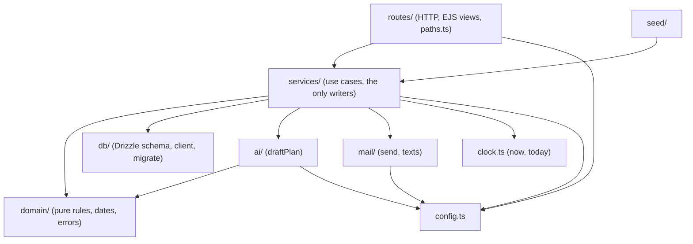
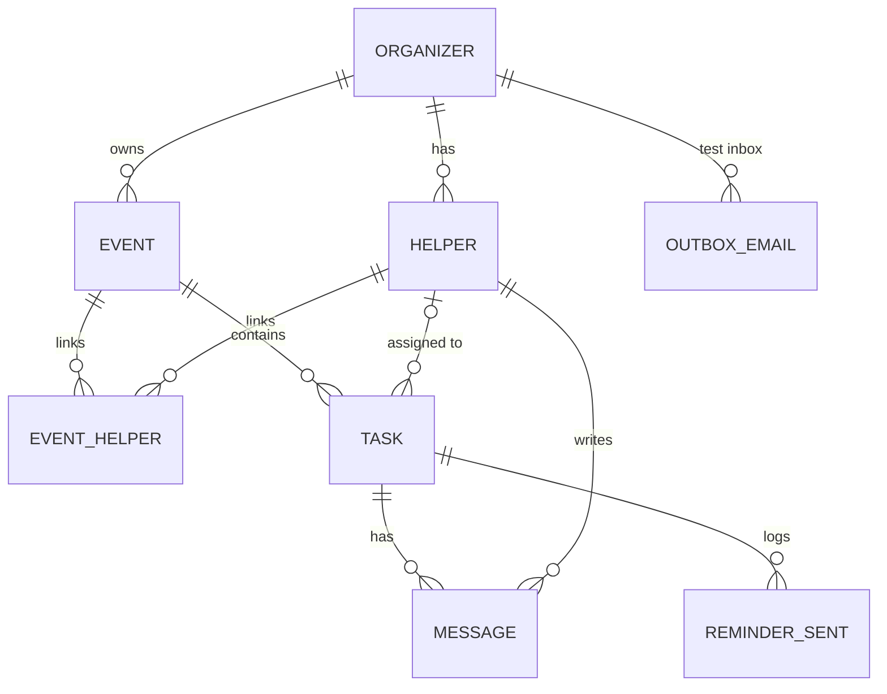
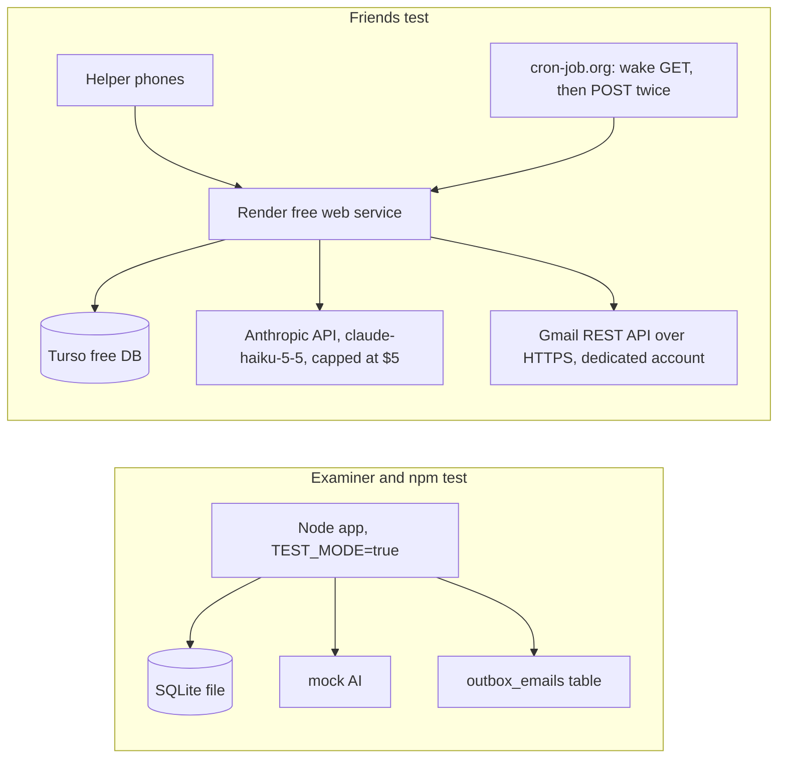

# Architecture Spine — MasterPlan v1

## Design Paradigm

**Layered monolith with a functional core.** One Node process serves server-rendered pages. Requests flow `routes → services → db`. All business rules live in `domain/`, which is pure: no I/O, no clock, no database. It takes "now", "today" and the current records as input and returns decisions.



Arrows are the only allowed dependency directions. `domain/` imports nothing from the project except its own files.

## Invariants & Rules

### AD-1 — Layer boundaries and request flow

- **Binds:** all
- **Prevents:** rules duplicated in routes or templates; pages writing to the database directly; links and notices built differently on each page.
- **Rule:**
  - **Routes** parse input with zod, call one service function, then redirect or render.
  - **Writes:** only `services/` writes to the database. Views receive plain data and never compute statuses.
  - **Links:** every URL is built by `routes/paths.ts`, using `APP_BASE_URL` for absolute links.
  - **Form posts** follow Post/Redirect/Get:
    - On success, redirect with a one-time session flash notice.
    - On a form validation error, re-render with HTTP 422.
    - On a `DomainError`, redirect with a flash.
  - **Error codes** live in one `domain/errors.ts` registry, which maps each `ErrorCode` to Norwegian text.

### AD-2 — One task state machine, one writer of tasks and messages

- **Binds:** FR-7, FR-9, FR-11, FR-13, FR-14, FR-15, FR-16, FR-20, FR-30, FR-31
- **Prevents:** two code paths changing a task with different side effects; answers counted twice; helpers assigned outside the event.
- **Rule:**
  - **Single writer.** `services/tasks` is the only writer of `tasks` and `messages` rows, including task creation from a plan.
  - **One entry point.** Every status change goes through `tasks.apply(actor, taskId, command, now)`, where:
    - `actor` is `{ kind: 'organizer', organizerId }` or `{ kind: 'helper', helperId, organizerId }`.
    - `command` is `{ action, helperId?, message? }`.
  - **Checking a move.** `apply` asks `domain/taskRules.transition(task, command, actor, eventHelperIds, now)` whether the move is allowed and which fields change.
  - **Event helpers only.** `assign` and `reassign` are refused unless the target helper is linked to the event in `event_helpers`.
  - **No double taps.** A command that would leave the status unchanged and carries no message does nothing.
  - **Messages.** Every helper command writes exactly one `messages` row in the same transaction, with columns `task_id`, `helper_id`, `action`, `status_after`, `body` (nullable), `created_at` and `seen_at` (null). Organizer commands write no message.
  - **Changed-task flag.** Any helper command clears `changed_since_answer` (AD-13).

  Allowed moves:

| From | Action (actor) | To | Field changes |
|---|---|---|---|
| Unassigned | assign (organizer) | Open | `helper_id` set, `assigned_at = now` |
| Open | yes (helper) | Accepted | `accepted_at = now` |
| Open | no (helper) | Declined | — |
| Accepted | no (helper) | Declined | `accepted_at = null` |
| Declined | yes (helper) | Accepted | `accepted_at = now` (new reminder clock) |
| Accepted | done / cantDo (helper) | Done / Can't be done | — |
| Done ↔ Can't be done | switch (helper) | the other | — |
| any | markDone (organizer) | Done | — |
| any except Unassigned | reassign / reopen (organizer) | Open | `helper_id` set, `assigned_at = now`, `accepted_at = null` |
| Open, Accepted, Declined, Can't be done | helper removed (organizer) | Unassigned | `helper_id = null`, `accepted_at = null` |

Done tasks keep their status and helper when the helper is removed. The helper page lists all of that helper's tasks except Unassigned ones, grouped by event and sorted by deadline. Its buttons come from `taskRules.allowedHelperActions(task)`.

### AD-3 — Derived states are computed, never stored

- **Binds:** FR-19, FR-20, FR-21, FR-25
- **Prevents:** stored flags drifting from the rules; overview and event view disagreeing.
- **Rule:** Urgent, Needs a helper, On track, the FR-20 counts and "next deadline" come only from `domain/status.ts` functions that take `(tasks, event, today)`.
  - **Needs a helper** covers:
    - Unassigned, Declined and Can't be done tasks.
    - An Open task assigned 7 or more Oslo calendar days ago.
    - An Open task whose deadline is today + 3 or earlier, including deadlines already past.
  - **Urgent** is an Accepted task with deadline ≤ today + 3.
  - **Counts:** M is all tasks in the event. The next deadline is the earliest deadline ≥ today among tasks not Done.
  - **Past events:** events whose date is before today are left out of Urgent and Needs a helper.

### AD-4 — One clock, one date module

- **Binds:** FR-5, FR-17, FR-21, FR-25, FR-27
- **Prevents:** time-zone bugs; 7-day and 14-day rules that give different results in different stories; tests that depend on the real date.
- **Rule:**
  - **Formats:** event dates and deadlines are stored as `YYYY-MM-DD` text. Timestamps are stored as ISO strings in UTC.
  - **The clock:** `clock.now()` and `clock.today()` (the Oslo date) are the only time sources. Services pass both into `domain/`.
  - **Conversions:** every conversion and day difference goes through `domain/dates.ts` (`osloDate(ts)`, `daysBetween(a, b)`, `addDays(d, n)`).
  - **No hidden timestamps:** no SQL `DEFAULT CURRENT_TIMESTAMP`, and no `new Date()` outside `clock.ts`.
  - **Tests** replace the clock with a fixed instant.

### AD-5 — Ownership and identity

- **Binds:** FR-2, FR-8, FR-30, NFR-2
- **Prevents:** one organizer seeing another's data; the same person duplicated or merged across organizers.
- **Rule:**
  - **Scoping:**
    - Organizer requests are scoped by `organizerId` from the session.
    - Helper requests are scoped by the helper that the token resolves to. They never read the session.
    - `reminders.run` is the only service that works across organizers.
  - **Helpers:**
    - Emails are trimmed and lowercased everywhere, the seed included.
    - A Helper is unique per `(organizer_id, email)` and owns one `link_token`.
    - Correcting an email issues a new token. It is refused with `email_in_use` if that organizer already has a helper with the new address.
    - Helper rows are never deleted.
    - An event links to at most five helpers through `event_helpers`.

### AD-6 — Helper link security

- **Binds:** FR-12, FR-13, FR-15, NFR-2
- **Prevents:** link previews changing data; a helper acting on someone else's task.
- **Rule:**
  - **Routes:** `GET /h/:token` is the helper page, and `GET /h/:token?view=accepted` is the reminder link, using the same token.
  - **Reads:** GET never changes data.
  - **Writes:** every helper POST goes through `tasks.apply` with the helper actor, so it is refused unless the helper is the task's current helper and AD-2 allows the move.
  - **Tokens:** 24 random bytes, base64url.
  - **Headers:** helper responses send `X-Robots-Tag: noindex`, `Referrer-Policy: no-referrer` and generic Open Graph tags.

### AD-7 — Reminders are computed at check time

- **Binds:** FR-7, FR-17, FR-18, FR-24, FR-26
- **Prevents:** stored schedules going stale after edits; duplicate or lost reminders.
- **Rule:**
  - **Finding due reminders:** `services/reminders.run(now, today)` selects Accepted tasks and asks `domain/reminderDue(task, today)`.
  - **When a reminder is due:** at whichever comes first, `osloDate(accepted_at) + 14` or `deadline − 3`. Nothing is due if the yes came after the 3-day point.
  - **Claim, then send:** for each due task, `run` first inserts a `reminders_sent` row, unique on `(task_id, accepted_at)`, then calls `mail.send`. If the send fails, it deletes the row so the next run retries. Each yes therefore sends at most one reminder, a late run catches up, and edits need no rescheduling.
  - **Triggers:**
    - `POST /internal/reminders/run` with header `X-Cron-Secret`, compared with `crypto.timingSafeEqual`. The route is mounted only when `CRON_SECRET` is set.
    - In test mode, the **Send due reminders now** button calls the same function.
  - **Daily schedule:** cron-job.org first sends a wake-up `GET /health`, then the POST 3 minutes later, and the POST again 10 minutes later. This is safe because the run is idempotent.

### AD-8 — The AI boundary

- **Binds:** FR-5, FR-6, FR-23, FR-26, NFR-3, NFR-4, NFR-6
- **Prevents:** provider code spread through the app; unvalidated AI output; personal data sent to the AI; no way to show which plan was used.
- **Rule:**
  - **One entry point.** `ai/draftPlan({ templateKey, eventDate, description, forceFailure })` is the only AI entry point. It returns `{ tasks, source: 'ai' | 'mock' | 'fallback', notice? }`.
  - **What it sends.** It never receives helper names or emails.
  - **One plan shape.** Every plan is a list of `{ title, daysBeforeEvent }`. Template files `src/templates/<key>.json` have the shape `{ key, name, defaultPlan: [{ title, daysBeforeEvent ≥ 0 }] }` and are validated by zod at startup. Each template has one matching mock plan.
  - **One validator.** Every plan goes through `domain/plan.ts`, which converts offsets to dates, sets any date before today to today, and validates. A plan is invalid if it doesn't match the schema, has no tasks, has more than 40 tasks, has a title over 120 characters, or has a deadline after the event date.
  - **Fallback.** An invalid plan, an API error, a call over 30 seconds, or `forceFailure` (honored only when `TEST_MODE` is on) returns the template plan with `source: 'fallback'` and a notice. With no `ANTHROPIC_API_KEY`, the mock is used with `source: 'mock'`.
  - **The provider.** The real provider lives only in `ai/anthropic.ts`:
    - model `claude-haiku-5-5`
    - `messages.parse` with a zod output format through `output_config.format`
    - effort `low`, `max_tokens` 2000
  - **Order of work.** `draftPlan` runs before the database transaction that creates the tasks.
  - **Disclosure.** The event form tells the organizer that her description is sent to an AI service.
  - **Simulated failure.** The test-mode toggle is stored in the session.

### AD-9 — The mail boundary and the test inbox

- **Binds:** FR-10, FR-18, FR-23, FR-24, NFR-7, NFR-9
- **Prevents:** emails leaking from test mode; the test inbox showing something different from what is sent; tone drifting between stories.
- **Rule:**
  - **One entry point.** `mail/send({ organizerId, to, subject, text, links, kind: 'helper_link' | 'reminder' })` is the only way to send. It looks up the organizer's name and email itself.
  - **Fixed texts.** All email text comes from `mail/texts.ts`. It is fixed, Norwegian, respectful and direct, with dates formatted `nb-NO`. A snapshot test covers the reminder text.
  - **Test mode.** With `TEST_MODE=true`, `send` inserts a row into `outbox_emails` with `organizer_id`, `to`, `from_name`, `reply_to`, `subject`, `text`, `links` (JSON), `kind` and `created_at`. The test inbox lists only the logged-in organizer's rows.
  - **Real sending.** `MAIL_TRANSPORT` chooses how mail leaves when `TEST_MODE` is off:
    - `gmail`: the message is built as MIME by Nodemailer's `MailComposer` and sent with the Gmail REST API (`users.messages.send`, HTTPS port 443) from the dedicated MasterPlan Gmail account. An access token is obtained from the stored refresh token through `google-auth-library`. The OAuth consent screen is set to "In production", so the refresh token does not expire after 7 days.
    - `disabled` (fallback D): `send` writes nothing and logs one line. The "send by email" button is hidden, and reminders are not sent. Helpers get links only through chat.
  - **Sender details.** The sender name is "MasterPlan på vegne av ‹organizer›", and `Reply-To` is set to the organizer's email.
  - **Failures.** A failed send throws `MailError`.

### AD-10 — Configuration is checked once

- **Binds:** FR-23, FR-27, FR-28, NFR-8
- **Prevents:** test mode switching on by accident; tests making paid calls; links pointing at localhost in production.
- **Rule:**
  - **One reader.** `config.ts` exports `loadConfig(env)`, called once at startup with `process.env`. No other module reads `process.env`.
  - **Tests.** Tests call `loadConfig` with an explicit test environment and never load `.env`.
  - **Independent settings.**
    - `TEST_MODE` turns on the test inbox, the test controls and the `/test/*` routes.
    - `ANTHROPIC_API_KEY` decides between the real AI and the mock.
    - `MAIL_TRANSPORT` (`gmail` or `disabled`) chooses how mail is sent. With `gmail`, `GMAIL_CLIENT_ID`, `GMAIL_CLIENT_SECRET`, `GMAIL_REFRESH_TOKEN` and `GMAIL_SENDER` are required.
    - `APP_BASE_URL` builds links. It defaults to `http://localhost:PORT` when `TEST_MODE` is on.
    - `PORT` defaults to 3000.
    - `DATABASE_URL` points at the database.
    - `DATABASE_AUTH_TOKEN` is required unless `DATABASE_URL` is a `file:` path.
    - `SESSION_SECRET` signs the session cookie.
    - `CRON_SECRET` protects the reminder trigger.
  - **Fail fast.** With `TEST_MODE` off, a missing or unknown `MAIL_TRANSPORT`, missing Gmail settings when it is `gmail`, a missing `APP_BASE_URL` or a missing `SESSION_SECRET` stop the app at startup with a clear error. There is never a silent fallback. `disabled` must be chosen explicitly.
  - **Template file.** `.env.example` lists every setting, with `TEST_MODE=true` and `DATABASE_URL=file:./data/local.db`.

### AD-11 — Seed and tests share one fixture

- **Binds:** FR-20, FR-25, FR-26, FR-27
- **Prevents:** the fixture table, the seed and the tests disagreeing; impossible rows; README links breaking on re-seed; test data on the deployed database.
- **Rule:**
  - **What `seed` builds.** `seed/seed.ts` exports `seed(db, clock)`. It builds the test organizer, both events, shared helpers and tasks in every status by calling services with a clock it moves backwards. It never inserts rows directly.
  - **Fixed tokens.** Seeded helpers use fixed tokens from `seed/fixture.ts`, so the links in the README keep working after a re-seed. `seed` returns the ids and tokens it created.
  - **Where it may run.** `npm run seed` refuses to run unless `TEST_MODE` is on and `DATABASE_URL` is a `file:` path. It resets the file before seeding.
  - **Expected counts.** `seed/fixture.ts` exports `EXPECTED_COUNTS`. `docs/fixtures.md` shows the same table, and one test asserts the counts.
  - **Valid rows.** A test checks every seeded task against `domain/taskRules.assertFieldInvariant` (for example, Accepted requires `accepted_at`).

### AD-12 — Foreign keys and deletion

- **Binds:** FR-7, FR-30, FR-32
- **Prevents:** orphan messages, reminders or outbox rows that still show up in counts.
- **Rule:**
  - **Foreign keys on.** `db/client.ts` runs `PRAGMA foreign_keys = ON` on every connection, and one test checks it.
  - **Cascades.**
    - `tasks → messages` and `tasks → reminders_sent` cascade.
    - `events → tasks` and `events → event_helpers` cascade.
    - `helpers` are never deleted (AD-5).
  - **Removing a helper** from an event deletes the `event_helpers` row and moves that helper's tasks as in AD-2.

### AD-13 — Changing an accepted task

- **Binds:** FR-7
- **Prevents:** a helper's yes silently covering a different task.
- **Rule:** when the organizer edits the title or deadline of an Accepted task, its status stays the same and `changed_since_answer = true` is set. The helper page then shows "Endret etter at du svarte" until the helper's next command. [ASSUMPTION]

### AD-14 — Migrations

- **Binds:** all stories that change the schema
- **Prevents:** parallel stories producing clashing migrations; the examiner's database missing tables.
- **Rule:**
  - **One schema file.** The schema lives in `db/schema.ts`.
  - **Committed migrations.** Each story that changes the schema adds one migration with `drizzle-kit generate`, after rebasing on main, and commits it. `drizzle-kit push` is never used.
  - **Applied everywhere.** `db/migrate.ts` applies pending migrations and is called by server start, `seed` and the test setup. The Quick Start needs no separate migrate step.

### AD-15 — New replies and "seen"

- **Binds:** FR-20, Glossary "New reply"
- **Prevents:** one story marking replies seen on any page view and another never marking them.
- **Rule:**
  - **What a New reply is:** a `messages` row with `seen_at = null`.
  - **When it becomes seen:** opening the Messages panel is a real request, `GET /events/:id?panel=messages`. That request calls `messages.listAndMarkSeen(organizerId, eventId, now)`, which sets `seen_at` only on the rows it returns. This is the one organizer GET that writes.

### AD-16 — Browser side

- **Binds:** FR-10, NFR-1, NFR-2
- **Prevents:** inline scripts blocked by the content security policy; cookies sent insecurely.
- **Rule:**
  - **Scripts.** No inline JavaScript. The copy-link button uses `public/copy.js`, with a read-only input showing the link as a fallback.
  - **Cookies.** The session cookie is `httpOnly` and `sameSite: 'lax'`, and `secure` when `TEST_MODE` is off.
  - **Headers.** helmet runs with its default headers.

## Consistency Conventions

| Concern | Convention |
| --- | --- |
| Naming | TypeScript files in camelCase. Database tables and columns in snake_case, with plural table names. Status values stored as `unassigned`, `open`, `accepted`, `declined`, `done`, `cant_do`. PRD Glossary terms are used in code names (`needsHelper`, `urgent`, `onTrack`). |
| IDs | Integer primary keys. `link_token` is the only identifier shown to helpers. |
| Validation | zod at the route boundary, the template files and the AI boundary. The domain trusts its inputs. |
| Auth | Passwords hashed with `node:crypto` scrypt, with a per-user salt. One `requireLogin` middleware guards organizer routes. Helper routes use the token only. |
| UI text | Norwegian, written directly in the EJS templates. No i18n library. |
| Transactions | One service call per request. Multi-row changes run in one database transaction. AI and mail calls happen outside transactions. |
| TypeScript | `module` and `moduleResolution` set to `nodenext`, `types: ["node"]`, `skipLibCheck: true`, `strict: true`. No tools that need the TypeScript compiler API (ts-node, typescript-eslint). |
| Node | `engines: ">=22.12"`. `.node-version` set to 24 for Render. |
| Logging | `console` only. One line per reminder run and per send failure. |

## Stack

| Name | Version |
| --- | --- |
| Node.js | ≥ 22.12 (Render runs 24.x) |
| TypeScript, run with tsx | typescript 7.0.2, tsx 4.23.15 |
| Express, EJS | 5.3.0, 7.0.2 (pinned exactly; fall back to 6.0.1 if a template feature breaks) |
| Drizzle ORM, drizzle-kit | 0.45.4, 0.31.11 (stay on 0.45.x, not `@rc`) |
| @libsql/client | 0.18.0 |
| zod | 4.6.7 |
| cookie-session, helmet | 2.1.1, 8.3.0 |
| @anthropic-ai/sdk, model `claude-haiku-5-5` | 1.3.0 |
| nodemailer (MailComposer for MIME), google-auth-library (Gmail API OAuth) | 10.2.1, 11.3.1 |
| Vitest (with peer vite), supertest | 5.0.5 (vite 8.3.5), 7.3.1 |
| @types/node, @types/express, @types/cookie-session, @types/nodemailer, @types/supertest | 24.x, 5.0.6, 2.0.49, 8.0.2, 7.2.1 |
| Hosting | Render free web service, Turso free database, cron-job.org (checked 2026-10-24) |

## Structural Seed

```text
masterplan/
  src/
    server.ts        # loadConfig, migrate, listen
    app.ts           # middleware, routes, error handler
    config.ts        # AD-10
    clock.ts         # AD-4
    domain/          # taskRules.ts, status.ts, plan.ts, reminderDue.ts, dates.ts, errors.ts
    services/        # auth, events, plans, helpers, tasks, messages, reminders
    ai/              # index.ts (draftPlan), schema.ts, mock.ts, anthropic.ts
    mail/            # index.ts (send), texts.ts, outbox.ts, transport.ts
    db/              # schema.ts, client.ts, migrate.ts, migrations/
    routes/          # paths.ts, organizer/, helper.ts, internal.ts, testMode.ts
    views/           # EJS templates (Norwegian)
    templates/       # wedding.json, bachelorette.json
  public/            # copy.js, styles
  seed/              # seed.ts, fixture.ts
  tests/             # Vitest + supertest
  docs/              # traceability.md, fixtures.md, cost-and-mock-plan.md
  .env.example
  .gitignore         # .env, data/, node_modules/
  .node-version
```





## Capability → Architecture Map

| Capability / Area | Lives in | Governed by |
| --- | --- | --- |
| FR-1, FR-2 account and isolation | services/auth, routes/organizer | AD-5, AD-16 |
| FR-3, FR-4, FR-29, FR-32 events | services/events | AD-1, AD-12 |
| FR-5, FR-6, FR-7 plan draft and editing | ai/, domain/plan.ts, services/plans, services/tasks | AD-8, AD-2, AD-13 |
| FR-8 to FR-11, FR-30 helpers and assignment | services/helpers, services/tasks | AD-2, AD-5 |
| FR-12 to FR-16, FR-31 helper page and answers | routes/helper.ts, services/tasks | AD-2, AD-6 |
| FR-17, FR-18 reminders | services/reminders, domain/reminderDue.ts, mail/ | AD-7, AD-9 |
| FR-19 to FR-22 overview and event view | domain/status.ts, services/messages, routes/organizer | AD-3, AD-4, AD-15 |
| FR-23 to FR-28 test mode, seed, tests, docs | config.ts, mail/outbox.ts, routes/testMode.ts, seed/, tests/, docs/ | AD-9, AD-10, AD-11, AD-14 |
| NFR-4, NFR-8 cost and deployment | Render, Turso, cron-job.org, Anthropic | AD-7, AD-8, AD-10 |

## Deferred

- **Gmail OAuth setup script:** a one-time `scripts/gmail-auth.ts` that prints a refresh token. Its exact steps are written in the deployment story.
- **Page styling and layout:** decided in the UX step or per story, following the PRD addendum. No CSS framework is fixed.
- **htmx or other client-side interactivity:** not needed for Must FRs.
- **Browser end-to-end tests (Playwright):** not in v1. Phone layout and clipboard are manual checks in `docs/traceability.md`.
- **CSRF tokens, login rate limiting:** low risk at course volume, given `sameSite: 'lax'` cookies. Revisit before any public launch.
- **Backups:** Turso's free tier only.
- **A second AI provider:** possible behind `ai/draftPlan`. Not built.
- **Story breakdown and story count:** decided in the epics-and-stories step.
